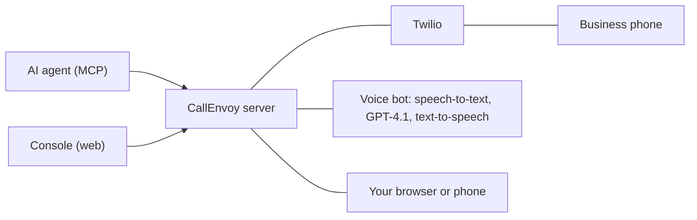

# CallEnvoy

An AI that makes your phone calls. Your AI agent (Claude Code, Codex, Claude Desktop, ChatGPT, Cursor, or any MCP client) asks CallEnvoy to call a business. The AI presses the menu keys, waits on hold, and talks to the person. You can listen in from your browser, take the call over, and hand it back.

- **Try it:** https://callenvoy.pragnyalabs.com . Sign in with an email link and place a free call to the demo line.
- **Your keys, your bill:** real calls run on your own Twilio and OpenAI accounts. You save the keys once in the console. A call costs about 3 to 7 cents a minute, paid to them; CallEnvoy charges nothing.
- **Open source (MIT).** Run your own copy: see [Run your own](#run-your-own).

The design and the MCP tool names follow [Call4me](https://github.com/skeptrunedev/call4me) (MIT) where that fits. Thank you to its author.

## How it works



1. The agent (or you, in the console) gives a number, the business, and the goal.
2. CallEnvoy dials. The AI gets through the phone menu and the hold, then talks to the person.
3. You get the outcome, the transcript and the recording. While the call runs you can get an alert, listen, take over, and hand back.

One Python process (FastAPI + [Pipecat](https://github.com/pipecat-ai/pipecat)) hosts the MCP endpoint, the Twilio webhooks and audio streams, one voice bot per call, the owner audio socket, web push, and the built console (an Expo web app). Data is one SQLite file in `data/`.

## Connect an agent

**Sign in from the agent (no key to copy).** Add the server, then let the agent open the browser:

```bash
claude mcp add --scope user --transport http callenvoy https://callenvoy.pragnyalabs.com/mcp
```

In Claude Code run `/mcp`, pick `callenvoy`, and choose Authenticate. In Claude Desktop and claude.ai: Settings > Connectors > Add custom connector, with the same address. You approve the agent on a CallEnvoy page; it then appears in your key list, where you can disable or delete it.

**Or with a key.** Create one on the console page **Agents**; the page shows these lines with the key filled in.

```bash
claude mcp add --scope user --transport http callenvoy https://callenvoy.pragnyalabs.com/mcp --header "Authorization: Bearer <key>"
```

Clients that cannot send headers use `https://callenvoy.pragnyalabs.com/mcp/<key>`. Prefer the header form: a key in a URL can end up in logs.

Tools (prefix `callenvoy_`): `place_call`, `get_call`, `hang_up`, `list_calls`, `answer_question`, `connect_me`, `hand_back`, `get_recordings`, `get_profile`, `save_profile`, `list_voices`, `verify_number`.

## Your own keys

| Provider | Needed | What it does | Where the key is made |
|---|---|---|---|
| Twilio (Account SID, Auth Token, one phone number) | yes | The phone line | https://console.twilio.com |
| OpenAI | yes | The AI that talks; also hearing and voice unless you add the two below | https://platform.openai.com/api-keys |
| Deepgram | optional | Hearing (speech-to-text) | https://console.deepgram.com |
| Fish Audio | optional | Ten more voices, three of them Indian English | https://fish.audio/app/api-keys |

- Save them in the console under **Settings > Provider keys**. Each key is checked with its provider, stored encrypted, and never shown again (only a short hint such as `AC…a3a8`). An agent key cannot read or change them.
- The voice follows the saved keys: with a Fish key the call speaks with a Fish voice, without one with an OpenAI voice. The same holds for Deepgram and hearing.
- Without your own keys you can place 3 short calls to the demo line (a made-up internet provider with a phone menu, a hold and a billing agent). Those run on the server's keys and cannot ring a phone.
- A required key cannot be replaced or removed while a call on it is running. Recordings stay in the Twilio account that made the call: after you switch to another Twilio account, a recording that was never played here can no longer be fetched.
- A Twilio trial account plays a trial message and calls only numbers you verified; upgrade it for real calls.
- Callbacks: set your Twilio number's voice webhook to the address shown under Provider keys. A business that calls back is then forwarded to your callback number, and the call shows in your list.

## Two call modes

| Mode | The AI | You |
|---|---|---|
| `handle` (default) | Does the whole call | Can get an alert when a person answers, listen, take over, hand back |
| `transfer` | Gets through the menu and the hold, then asks the person to wait | Get an alert in the console, then a phone ring, and join |

You join in the browser (audio goes through the server; headphones recommended) or on your phone (key 1 takes over, `*` hands back).

Menu keys: Twilio cannot send keys on an open audio stream, and a Twilio menu ignored tones in the audio in tests. For each key press the call leaves its stream, Twilio plays the digits as real key signals, and the call joins a new stream; the next bot continues with the same context. About one second of audio is not heard during this change.

## Alerts

Sound and browser notification while the console is open; web push when it is closed; then the phone ring. Turn them on in **Settings > Alerts on this device**. On an iPhone, web push works only after you add the console to the home screen (Share > Add to Home Screen).

## Settings

All settings have defaults, and you can change them in the console and with `callenvoy_save_profile`; most also per call. Main ones: `mode`, `reach` (`app`, `phone`, `app_then_phone`), `alert_wait_seconds`, `no_answer`, `alert_on_human`, `listen_in`, `voice`, `record_calls`, `max_minutes`, `caller_id` (`callenvoy`: your Twilio number, or `own`: your verified personal number), `leave_voicemail`, and the calling profile (name, callback number, address, insurance, vehicle, travel numbers, free text). The saved profile is used only on calls placed for you, not on a call you place for someone else. Safety limits are constants in `callenvoy/config.py` and cannot be changed through MCP.

## Voices

| Provider | Voices |
|---|---|
| OpenAI (every account) | Marin, Coral, Nova (female); Cedar, Ash, Onyx (male). Marin is the default. |
| Fish Audio (with a Fish key) | Hannah, Sarah, Laura (female, US); Sophia (female, British); Ethan, Adrian, Jordan (male, US); Rohan, Vikram (male, Indian English); Meera (female, Indian English). Hannah is the default. |

`callenvoy_list_voices` returns the voices your calls can use, with sample links. The three Indian English voices are community voices on Fish Audio; if one is removed, calls use the default voice.

## Limits and rules

- US and Canada numbers only; premium and non-US/Canada area codes are blocked. No emergency numbers.
- Per user: 2 calls at one time and 240 call minutes a day. 30 minutes planned per call (extended on hold or in a live talk), 120 at most. The server as a whole runs 4 calls at one time.
- The AI says it calls on your behalf. It does not claim to be you, and it says it is an AI when sincerely asked.
- Calls are recorded by default (a setting). Some US states require all parties to agree to a recording; that is the duty of the user who places the call.
- Do not use it for spam, harassment or robocalls. The admin can disable an account.

## Privacy

- Each user has their own calls, transcripts, recordings, profile, keys and alert devices. A call id of another user answers like an unknown id (404).
- The admin (the user whose email is `OWNER_EMAIL`) sees usage numbers only: name, email, joined, last active, calls, minutes. Never call content.
- Call audio is processed by Twilio and OpenAI, and by Deepgram and Fish Audio when those keys are in use. Recordings stay in the Twilio account that made the call; the server keeps an mp3 copy in `data/recordings/` after the first play. Recording links `/r/<token>` are token links: share one only on purpose.
- You can delete your account and all its data in **Settings > Account**.

## Run your own

You need a Linux server with a public https address, `uv`, and nginx; Node 22.13+ and `pnpm` on the machine that builds the console.

1. Copy `.env.example` to `.env` on the server (mode 600) and fill it in: the public address, the server's own provider keys (they serve the admin and the free demo calls), `OWNER_EMAIL`, mail settings for sign-in links, and `CALLENVOY_SECRET_KEY` (`uv run python -m callenvoy.keys --make-key`), which encrypts the keys that users save. Keep that value: without it saved keys cannot be read.
2. Install `deploy/callenvoy.service` as a systemd unit and `deploy/nginx.conf` as an nginx site (WebSocket upgrade and `X-Forwarded-For` matter).
3. Run `deploy/deploy.sh <ssh-host>`. It builds the console, copies the code and `client/dist`, runs `uv sync`, restarts the unit and checks `/healthz`.
4. In Twilio, set the voice webhook of the server's number to `<address>/twilio/inbound`. For the demo line, buy a second number, set its voice webhook to `<address>/api/demo-line`, and put it in `DEMO_LINE_NUMBER` in `callenvoy/config.py`.
5. First sign-in without mail, or recovery: `uv run python -m callenvoy.signin [email]` prints a one-time link.

`PUBLIC_BASE_URL` may include a path (`https://example.com/callenvoy`) when the service shares a host; agent sign-in in the browser needs the root of a host, because OAuth discovery addresses are fixed there.

### Run locally

```bash
cp .env.example .env.local   # fill in the values; CALLENVOY_DEV=1
set -a; . ./.env.local; set +a
pnpm --dir client install && pnpm --dir client run build
uv run uvicorn callenvoy.main:app --host 127.0.0.1 --port 3021
```

Real calls need a public https address for Twilio's webhooks. Console development without the server: `pnpm --dir client run build`, then `pnpm --dir client run mock`. The mock serves the built console with sample data at `http://localhost:3020/`; open `/__mock/signin` to sign in.

Web push keys: `uv run python -m callenvoy.push --make-keys`. Voice samples (a few cents of Fish and OpenAI credit): `uv run python -m callenvoy.make_voice_samples`.

### Sign-in, keys and users

| Credential | How | Opens |
|---|---|---|
| Agent key | `Authorization: Bearer <key>` or `/mcp/<key>`; made in the console, or by a browser sign-in from the agent | `/mcp`, `/api/calls*`, `/api/profile`, `/api/config`, `/api/caller-id*` |
| Console session | cookie `ce_session` after an email sign-in link (30 days) | every `/api/*` route, including the console-only agent keys, provider keys, push devices, agent sign-in approval and account deletion; `/api/admin/*` for the admin only |

- Agent keys look like `ce_live_` + 32 characters. Up to 20 per user, each with a name, a last-used time, and Disable / Enable / Delete. A key is shown once; the server stores only its SHA-256 hash.
- Open sign-up: the account is created at the first sign-in with an email link (15 minutes, one use). Link requests are limited per address, per client IP and in total (`SIGNIN_LIMIT_*` in `callenvoy/config.py`).
- The admin's **People** page shows usage and whether a user has their own keys, and can disable, enable and remove a user. The switch **New sign-ups** closes sign-up for new addresses.
- A refused request gets 401 `{"error", "code"}` with `code` one of `no_credential`, `bad_key`, `key_disabled`, `malformed_key`, `session_expired`, `account_disabled`. An agent key on a console-only route gets 403 `owner_only`; a console write from a foreign `Origin` gets 403 `bad_origin`. A call that needs own keys gets 403 `keys_needed`; a used-up demo allowance gets 429 `demo_limit`.
- Do not change `OWNER_EMAIL` without care: the admin is whoever has that address.

## Tests

```bash
uv run pytest                      # service checks, no network
pnpm --dir client run typecheck
pnpm --dir client test
```

## Not built yet

A native mobile app (the console is an Expo project, so screens and logic are shared), native push, SMS alerts, an AI that answers callbacks (callbacks forward to your phone), scheduled calls, numbers outside the US and Canada, and a keypad in the console.

## History

This repository first held the hackathon project HoldForMe / CallOrHold4Me (a Next.js app). CallEnvoy replaced it.
